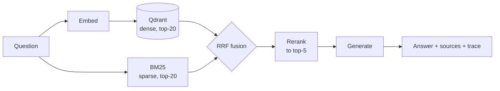

# RAG service

Hybrid document retrieval with a reranking stage, per-stage tracing, and an
evaluation suite that produces the numbers in this README.

```bash
cp .env.example .env     # add a key, or set RAG_PROVIDER=local
docker compose up
```

## Why this exists

Most public RAG examples stop at "it answered my question." They report no
retrieval metric, no latency breakdown and no cost, so there is no way to tell
whether the reranker earns its latency, whether the hybrid beats plain vector
search, or what a query actually costs.

This service is built so those questions have answers. Every stage is timed and
traced, every configuration is one switch away from its alternative, and the
evaluation runs with one command and writes a table nobody edits by hand.

## Architecture



**Hybrid, fused by rank.** Dense vectors find paraphrases; BM25 finds exact
identifiers — a fault code like `F-101` or a filename like `vx7.fw` is a
lexical match that embeddings routinely blur. The two lists are merged with
reciprocal rank fusion rather than a weighted score blend, because cosine
similarity and BM25 scores live on incompatible scales and any fixed weighting
between them is a calibration that breaks the moment the embedding model
changes.

**Reranking is a separate, measurable stage.** It can be turned off with one
config flag, so its value is a measurement rather than an assumption — see
Results.

**Tracing is local first.** Spans are collected in-process and returned in the
`/query` response; they are mirrored to Langfuse when keys are configured. A
trace that lives only in a SaaS dashboard can't be asserted on in a test or
summarised in an eval table.

**One provider switch.** `RAG_PROVIDER=cloud` uses an OpenAI-compatible API;
`local` uses Ollama. Nothing downstream branches on it. A third value, `fake`,
uses a deterministic hash embedder and an extractive reader — no network, no
keys — which is what the test suite and CI run against.

## Running it

```bash
docker compose up                      # qdrant + langfuse + api
docker compose --profile local up      # also starts ollama

# index the sample corpus
curl -X POST localhost:8000/ingest \
     -H 'content-type: application/json' \
     -d '{"path": "data/sample"}'

# ask something
curl -X POST localhost:8000/query \
     -H 'content-type: application/json' \
     -d '{"question": "What triggers the dry run fault?"}'
```

For the local provider, pull the models once the stack is up:

```bash
docker compose exec ollama ollama pull nomic-embed-text
docker compose exec ollama ollama pull llama3.1:8b
```

| Endpoint | Purpose |
|---|---|
| `POST /ingest` | Index raw text or a path on the server |
| `POST /query` | Retrieve and generate; returns answer, sources and the trace |
| `POST /retrieve` | Retrieval only — no generation, no generation cost |
| `GET /chunks/{id}` | One chunk with its neighbours, for reading around a hit |
| `GET /documents/{id}` | Every chunk of one document, in order |
| `GET /stats` | Index size and active configuration |
| `GET /health` | Liveness |

## Evaluation

```bash
python -m eval.run --variants cloud,cloud-norerank,local
```

Writes `results/raw/<variant>.json` (every case, every span) and
`results/EVAL.md` (the summary). The eval set is `eval/cases.yaml`.

Three choices in the harness are worth stating, because they decide whether
the numbers mean anything:

**Ground truth is document-level, not chunk-level.** Chunk ids change whenever
`chunk_size` changes, so chunk-level ground truth would silently invalidate the
eval set on a config change. Documents survive re-chunking.

**The ranking is deduplicated to documents before scoring.** Retrieval returns
several chunks per document; scoring that list directly counts one relevant
document at several ranks. That bug produced an nDCG of 1.239 here during
development — above the theoretical maximum of 1.0, which is how it was caught.
There is a regression test for it.

**A third of the eval set is unanswerable on purpose.** Cases marked
`answerable: false` have no supporting document, and a correct system refuses
them. Without such cases an eval set rewards confident guessing, which is the
failure mode that matters most in production.

Answer quality is measured by keyword coverage and groundedness, not an LLM
judge. A judge from the same model family that wrote the answer measures
agreement rather than correctness, and it can't be reproduced by someone
cloning this repo without keys.

## Results

<!-- numbers:start -->

Sample corpus: 4 documents, 12 chunks, 13 eval cases, 11 of them answerable,
`k = 5`. Produced by `python -m eval.run`; full table in `results/EVAL.md`.

| Variant | hit@5 ↑ | nDCG@5 ↑ | MRR ↑ | coverage ↑ | refusal ↑ | p50 ms ↓ | USD / query ↓ |
|---|---|---|---|---|---|---|---|
| local, rerank | 1.000 | 0.966 | 0.955 | 0.818 | 1.000 | 10203.6 | 0.000000 |
| local, no rerank | 1.000 | 0.966 | 0.955 | 0.818 | 1.000 | 2267.6 | 0.000000 |
| offline, rerank | 0.909 | 0.802 | 0.758 | 0.500 | 0.000 | 2.0 | 0.000000 |
| offline, no rerank | 1.000 | 0.914 | 0.894 | 0.500 | 0.000 | 1.6 | 0.000000 |
| cloud | — | — | — | — | — | — | — |

**local** is Ollama end to end: `nomic-embed-text` for embeddings,
`qwen2.5:7b` for generation and for the reranker. **offline** is the `fake`
provider — a deterministic hash embedder and a sentence-extracting reader —
which needs no model at all and is what CI runs. The cloud row is empty
because it has not been run; `scripts/check_readme_numbers.py` fails the build
if any figure here is absent from `results/raw/`.

### What a real model changes

**It can refuse, and the stand-in cannot.** Refusal rate goes from 0.000 to
1.000: `qwen2.5:7b` declined both questions the corpus genuinely cannot answer
("The context provided does not contain any information about the cost of a
Vertex-7 controller"), where the extractive reader always returns its best
sentences no matter how irrelevant. Keyword coverage rises the same way,
0.500 to 0.818.

**Groundedness falls, 1.000 to 0.809, and that is the metric working.** A
sentence-copier cannot use a word the context did not supply, so it scores a
perfect 1.000 by construction. A real model paraphrases. Read groundedness as
"did the answer introduce vocabulary from nowhere", not as a quality score —
below roughly 0.5 would be worth investigating; 0.809 is a model writing
normally.

### What the reranker is worth here: nothing, at three quarters of the latency

The two local rows are identical on every retrieval metric to four decimals,
and identical on coverage. The reranker is not broken — it reordered 2 of the
13 cases, leaving 11 untouched — but the two changes cancelled out:

- `duty-rotation`: promoted `controller-overview`, which is the right
  document. An improvement.
- `config-restore`: promoted `alarms` over `maintenance`, which is the right
  one. A regression.

For that, it costs 7480.2 ms of a 10203.6 ms median query — more than twice
what generation itself costs (2781.9 ms), and the reason p50 drops to
2267.6 ms without it. A listwise prompt over 20 candidates is simply a bigger
prompt than the one that writes the answer.

The honest conclusion is not "reranking is useless" but "this corpus cannot
show its value": fusion alone already retrieves the right document for every
case (hit@5 1.000, MRR 0.955), so there is nothing left to fix. Reranking
earns its latency when retrieval is imperfect, and here retrieval is not.

### Retrieval has saturated — the eval set is now the bottleneck

hit@5 and recall@5 are both 1.000 with a real embedding model. Four documents
and 13 questions can no longer separate any two configurations, which is why
the differences above come down to single cases. Growing the eval set is the
next piece of work, not tuning anything.

Note the offline rows disagree with the local ones about the reranker: there
it *lowered* hit@5 from 1.000 to 0.909. That was also one case. Two runs, two
directions, both inside the noise of a 13-case set — which is the clearest
argument for a bigger one.

<!-- numbers:end -->

## Limitations

Stated plainly, because they affect how much the table above is worth.

- **The corpus is four short synthetic documents, and retrieval has saturated
  on it.** hit@5 and recall@5 are both 1.000 with a real embedding model, so
  the fixture can no longer separate two configurations. Numbers from it
  predict nothing about a corpus of thousands of documents, where recall
  degrades and reranking starts to matter.
- **Thirteen eval cases is too few**, as the reranker comparison above
  demonstrates: every difference in the table traces back to one or two
  individual cases.
- **Local latency is one machine's.** The local rows were measured on an
  Apple Silicon laptop running the model through Ollama. They describe that
  machine, not the architecture — treat the ratio between stages as the
  transferable part, not the absolute milliseconds.
- **Groundedness is not a quality score.** A sentence-copier scores 1.000 by
  construction and a real model scores lower for paraphrasing. It detects
  vocabulary that came from nowhere, nothing more.
- **Cost for local models is API spend, which is zero.** It says nothing about
  the hardware the model runs on or the electricity it consumes.
- **No reranking cross-encoder.** The LLM reranker is a listwise prompt, which
  is cheaper to run but weaker than a trained cross-encoder on long candidate
  lists.
- **Single-turn only.** No conversation history, no query rewriting, no
  multi-hop retrieval.

## Layout

```
src/rag/
├── config.py      settings; the cloud/local/fake switch
├── embeddings.py  OpenAI-compatible, Ollama, deterministic
├── chunking.py    paragraph-aware splitting with content-derived ids
├── store.py       Qdrant wrapper; ":memory:" for tests
├── retrieval.py   BM25 index and reciprocal rank fusion
├── rerank.py      identity, lexical and LLM rerankers
├── llm.py         chat backends with token accounting
├── tracing.py     spans, Langfuse export, cost calculation
├── pipeline.py    ingest and query orchestration
└── api.py         FastAPI
eval/
├── cases.yaml     the eval set
├── metrics.py     recall, hit, precision, nDCG, MRR, coverage, groundedness
└── run.py         one command; writes results/
scripts/
└── check_readme_numbers.py   fails if this README cites an unmeasured number
```

## Tests

```bash
pytest
```

56 tests, no container and no keys required — they run against an in-process
Qdrant with the deterministic embedder, exercising the same code path as
production.

## License

MIT — see [LICENSE](LICENSE).
