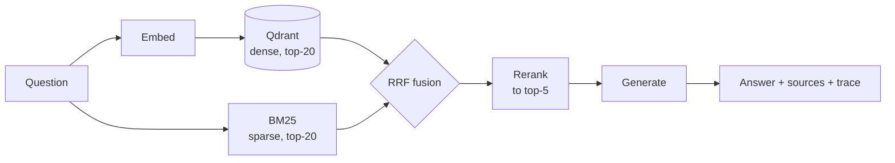

# RAG service

Hybrid document retrieval with a reranking stage, per-stage tracing, and an
evaluation suite that produces the numbers in this README.

```bash
cp .env.example .env     # add a key, or set RAG_PROVIDER=local
docker compose up
```

## Why this exists

Most public RAG examples stop at "it answered my question." They report no
retrieval metric, no latency breakdown and no cost, so there is no way to tell
whether the reranker earns its latency, whether the hybrid beats plain vector
search, or what a query actually costs.

This service is built so those questions have answers. Every stage is timed and
traced, every configuration is one switch away from its alternative, and the
evaluation runs with one command and writes a table nobody edits by hand.

## Architecture



**Hybrid, fused by rank.** Dense vectors find paraphrases; BM25 finds exact
identifiers — a fault code like `F-101` or a filename like `vx7.fw` is a
lexical match that embeddings routinely blur. The two lists are merged with
reciprocal rank fusion rather than a weighted score blend, because cosine
similarity and BM25 scores live on incompatible scales and any fixed weighting
between them is a calibration that breaks the moment the embedding model
changes.

**Reranking is a separate, measurable stage.** It can be turned off with one
config flag, so its value is a measurement rather than an assumption — see
Results.

**Tracing is local first.** Spans are collected in-process and returned in the
`/query` response; they are mirrored to Langfuse when keys are configured. A
trace that lives only in a SaaS dashboard can't be asserted on in a test or
summarised in an eval table.

**One provider switch.** `RAG_PROVIDER=cloud` uses an OpenAI-compatible API;
`local` uses Ollama. Nothing downstream branches on it. A third value, `fake`,
uses a deterministic hash embedder and an extractive reader — no network, no
keys — which is what the test suite and CI run against.

## Running it

```bash
docker compose up                      # qdrant + langfuse + api
docker compose --profile local up      # also starts ollama

# index the sample corpus
curl -X POST localhost:8000/ingest \
     -H 'content-type: application/json' \
     -d '{"path": "data/sample"}'

# ask something
curl -X POST localhost:8000/query \
     -H 'content-type: application/json' \
     -d '{"question": "What triggers the dry run fault?"}'
```

For the local provider, pull the models once the stack is up:

```bash
docker compose exec ollama ollama pull nomic-embed-text
docker compose exec ollama ollama pull llama3.1:8b
```

| Endpoint | Purpose |
|---|---|
| `POST /ingest` | Index raw text or a path on the server |
| `POST /query` | Retrieve and generate; returns answer, sources and the trace |
| `POST /retrieve` | Retrieval only — no generation, no generation cost |
| `GET /chunks/{id}` | One chunk with its neighbours, for reading around a hit |
| `GET /documents/{id}` | Every chunk of one document, in order |
| `GET /stats` | Index size and active configuration |
| `GET /health` | Liveness |

## Evaluation

```bash
python -m eval.run --variants cloud,cloud-norerank,local
```

Writes `results/raw/<variant>.json` (every case, every span) and
`results/EVAL.md` (the summary). The eval set is `eval/cases.yaml`.

Three choices in the harness are worth stating, because they decide whether
the numbers mean anything:

**Ground truth is document-level, not chunk-level.** Chunk ids change whenever
`chunk_size` changes, so chunk-level ground truth would silently invalidate the
eval set on a config change. Documents survive re-chunking.

**The ranking is deduplicated to documents before scoring.** Retrieval returns
several chunks per document; scoring that list directly counts one relevant
document at several ranks. That bug produced an nDCG of 1.239 here during
development — above the theoretical maximum of 1.0, which is how it was caught.
There is a regression test for it.

**A third of the eval set is unanswerable on purpose.** Cases marked
`answerable: false` have no supporting document, and a correct system refuses
them. Without such cases an eval set rewards confident guessing, which is the
failure mode that matters most in production.

Answer quality is measured by keyword coverage and groundedness, not an LLM
judge. A judge from the same model family that wrote the answer measures
agreement rather than correctness, and it can't be reproduced by someone
cloning this repo without keys.

## Results

<!-- numbers:start -->

Sample corpus: 4 documents, 13 eval cases, 11 of them answerable, `k = 5`.
Produced by `python -m eval.run`; full table in `results/EVAL.md`.

| Variant | hit@5 ↑ | nDCG@5 ↑ | MRR ↑ | keyword coverage ↑ | p50 ms ↓ | USD / query ↓ |
|---|---|---|---|---|---|---|
| offline (`fake`) | 0.909 | 0.802 | 0.758 | 0.500 | 2.1 | 0.000152 |
| offline, no rerank | 1.000 | 0.914 | 0.894 | 0.500 | 1.5 | 0.000160 |
| cloud | — | — | — | — | — | — |
| cloud, no rerank | — | — | — | — | — | — |
| local (Ollama) | — | — | — | — | — | — |

The two offline rows are real measurements of the `fake` provider: a
deterministic hash embedder, BM25, RRF and a lexical reranker, with an
extractive reader standing in for generation. They establish the floor —
whatever a real embedding model and a real LLM add, they have to beat this.

The cloud and local rows are empty because they have not been run. Filling
them needs a key or a local model; the command is above. **No number appears
in this README until a run produces it** — `scripts/check_readme_numbers.py`
fails the build if any figure here is absent from `results/raw/`.

### What the offline rows already show

**Reranking is not free, and here it is not obviously positive.** It costs
0.5 ms of the 2.1 ms median query and moves hit@5 *down*, from 1.000 to 0.909,
while leaving answer quality unchanged — keyword coverage is 0.500 either way.

Before reading anything into that: the hit@5 difference is **one case out of
eleven** (`duty-rotation`). Eleven cases cannot resolve a nine-point
difference. The honest conclusion is that this eval set is too small to judge
the reranker, and the next thing to do is grow the eval set, not tune the
reranker.

**Keyword coverage of 0.500 is a property of the offline reader, not of
retrieval.** Groundedness is 1.000 — every word of every answer came from the
retrieved context — while coverage sits at half, because the extractive
stand-in returns the best-matching sentence and the one after it, and several
eval cases require two facts from further apart. Retrieval found the right
document in 10 of 11 cases; the stand-in simply cannot compose. That gap is
what a real generator is for, and it is why the cloud and local rows matter.

**The time goes where you would not guess.** Median per stage, offline:
embed 0.1 ms, dense search 0.8 ms, sparse search 0.2 ms, fusion 0.0 ms,
rerank 0.5 ms, generate 0.3 ms. With a real model, generation will dominate
everything else by two orders of magnitude — which is exactly why the
`/retrieve` endpoint exists, so retrieval can be tuned without paying for
generation on every iteration.

<!-- numbers:end -->

## Limitations

Stated plainly, because they affect how much the table above is worth.

- **The corpus is four short synthetic documents.** It is a fixture for
  exercising the pipeline, not a workload. Numbers from it predict nothing
  about a real corpus of thousands of documents, where recall degrades and
  the reranker usually starts earning its place.
- **Thirteen eval cases is too few**, as the reranker comparison above
  demonstrates. Differences smaller than roughly one case — nine points — are
  noise.
- **The offline provider cannot refuse.** The extractive reader always returns
  its best sentences, so `refusal_rate` is 0.000 for both offline rows. That
  number measures the stand-in, not the system; it becomes meaningful only
  with a real generator.
- **Cost for local models is API spend, which is zero.** It says nothing about
  the hardware the model runs on or the electricity it consumes.
- **No reranking cross-encoder.** The LLM reranker is a listwise prompt, which
  is cheaper to run but weaker than a trained cross-encoder on long candidate
  lists.
- **Single-turn only.** No conversation history, no query rewriting, no
  multi-hop retrieval.

## Layout

```
src/rag/
├── config.py      settings; the cloud/local/fake switch
├── embeddings.py  OpenAI-compatible, Ollama, deterministic
├── chunking.py    paragraph-aware splitting with content-derived ids
├── store.py       Qdrant wrapper; ":memory:" for tests
├── retrieval.py   BM25 index and reciprocal rank fusion
├── rerank.py      identity, lexical and LLM rerankers
├── llm.py         chat backends with token accounting
├── tracing.py     spans, Langfuse export, cost calculation
├── pipeline.py    ingest and query orchestration
└── api.py         FastAPI
eval/
├── cases.yaml     the eval set
├── metrics.py     recall, hit, precision, nDCG, MRR, coverage, groundedness
└── run.py         one command; writes results/
scripts/
└── check_readme_numbers.py   fails if this README cites an unmeasured number
```

## Tests

```bash
pytest
```

56 tests, no container and no keys required — they run against an in-process
Qdrant with the deterministic embedder, exercising the same code path as
production.

## License

MIT — see [LICENSE](LICENSE).
